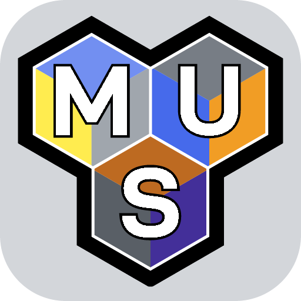

# Minecraft Universal Server

<p align="center">
  
</p>

<p align="center"><strong>One world. Java + Bedrock. Any device.</strong></p>

**Minecraft Universal Server (M.U.S.) helps you set up and manage one Minecraft world that Java Edition and Bedrock Edition players can join together.** It guides you from a fresh Raspberry Pi or desktop setup through server installation, player access, backups and maintenance.

M.U.S. is an independent desktop application for **macOS, Windows and Linux**. The Minecraft server can run on the same computer as the app or on a Raspberry Pi. The app is not a Minecraft client and does not host a public relay: players connect to your server over your local network or through network access that you configure.

[Download a build](https://github.com/djms66/Minecraft-Universal-Server/releases) · [Browse the source](https://github.com/djms66/Minecraft-Universal-Server) · [Report a problem](https://github.com/djms66/Minecraft-Universal-Server/issues)

## What you can do

- Create a shared Java/Bedrock server using Paper, Geyser and Floodgate.
- Follow a guided setup on a computer or prepare a Raspberry Pi from a blank SD card or SSD. First boot can use Wi-Fi or Ethernet.
- Manage a server, its Java and Bedrock allowlist, status and logs from the app.
- Create and restore verified server backups without overwriting an existing server folder or backup.
- Check supported component versions and apply coordinated updates with a rollback copy when the app can verify compatibility.
- Use advanced controls for server settings, approved plugins and Bedrock resource packs.
- Choose from 11 languages for the screens currently translated. Localization is still incomplete; Minecraft and third-party diagnostic messages remain in their original language.

## Get started

1. Open [Releases](https://github.com/djms66/Minecraft-Universal-Server/releases) and choose a package for your computer. Check the release notes and platform status below before installing.
2. Choose **This computer** to host the server locally, or **Raspberry Pi** to prepare or manage a Pi.
3. For a new Pi, connect its blank SD card or SSD to the computer running M.U.S. Select **Detect storage**, confirm the device and capacity, then confirm the erase operation. The system image and first-boot settings are written to that storage. Existing data on the selected device will be erased.
4. Configure Wi-Fi or use Ethernet. For Wi-Fi, the Pi and the computer must join the same router. The Wi-Fi password is temporarily written to the boot media so the Pi can join the network; the app schedules its removal on first boot. Use Ethernet if you do not want the password written to the card.
5. Insert the prepared storage into a powered-off Pi, connect it to the same router, then turn it on. Accept the Minecraft EULA in the app when prompted. M.U.S. searches for the Pi, verifies its SSH identity and hardware, then installs the server when it can confirm the target.
6. When setup completes, use the server dashboard to start the server, add the Java profile names or Bedrock gamertags that should be allowed to join, and copy the address shown by the app.

For a local server, keep the computer awake while the server is running. On a Pi, the Pi hosts the server and must remain powered on. Players on the same home network connect using the displayed local address. Inviting players over the internet may require router configuration and firewall rules; M.U.S. does not configure those on your behalf.

## Platform and release status

The project targets desktop builds for macOS (Apple silicon and Intel), Windows x64, and Linux x64/ARM64. A build produced by CI is not proof that an installer has been tested on a real computer. Check the current [release](https://github.com/djms66/Minecraft-Universal-Server/releases) and [build workflow](https://github.com/djms66/Minecraft-Universal-Server/actions) for the status of each package.

- **macOS:** packages are not notarized with an Apple Developer ID, so Gatekeeper may show a warning.
- **Windows:** packages are not signed with a publisher certificate, so SmartScreen may show a warning.
- **Linux:** packages require a compatible graphical desktop and the Tauri/WebKit system libraries. The ARM64 package is for desktop Linux; it does not run the graphical app on Raspberry Pi OS Lite.
- **Raspberry Pi:** the Pi is a server target managed by the desktop app. The compact server profile is designed to support Raspberry Pi 3B+ and later ARM64 models. The guided image workflow targets compatible 64-bit Raspberry Pi OS. A generated image or successful build does not replace testing first boot and server operation on the exact Pi and storage device.
- **iOS, iPadOS and Android:** there are no mobile app builds. These devices can use Minecraft Bedrock as clients if their Minecraft version and network can reach the server.

Windows and Linux packages need hands-on testing on their target systems. Until native install, launch, disk preparation and server-management flows have been confirmed on those systems, treat those packages as **tester builds**, not verified releases. See [CONTRIBUTING.md](CONTRIBUTING.md) if you can help test them.

## Java and Bedrock compatibility

M.U.S. combines a Java server (Paper) with Geyser and Floodgate so compatible Bedrock clients can join the same world as Java players. It checks upstream component information when preparing or updating a managed server and verifies downloaded files before installation. Minecraft Java and Bedrock do not always use the same version number; compatibility depends on the versions supported by the selected Geyser build.

This does not guarantee compatibility with every mod, plugin, resource pack, console, Minecraft preview, or third-party client. Advanced changes can affect compatibility. The app blocks some updates when it detects unsupported customizations or cannot establish that the components work together. Review the release notes before updating an existing server.

## Backups, updates and data safety

- Disk preparation is destructive. M.U.S. identifies the selected device and asks for confirmation before writing; never select a disk that contains data you need.
- New server installs and restores use a new folder. Existing server folders and backups are not silently replaced.
- Backup and restore operations validate the archive and its paths. Keep an additional copy of important worlds outside the server device.
- Managed updates check component versions and server state before applying changes. When an update cannot be validated, it is blocked; where rollback is supported, the prior server copy is retained.
- Downloads use HTTPS and integrity checks where upstream checksums are available. SSH management uses the app's key and requires host identity approval; do not share private keys or diagnostic logs containing secrets.
- If you configure Wi-Fi for first boot, the password is present temporarily on the boot media. Prefer Ethernet if that is not acceptable for your setup.

These safeguards reduce accidental data loss; they do not replace a separate backup or make every hardware, network, and third-party failure impossible.

## Build from source

The desktop app uses Tauri, Rust, React and TypeScript. Install Node.js, Rust, and the native build dependencies listed in the [Tauri prerequisites](https://v2.tauri.app/start/prerequisites/) for your operating system. Then run:

```sh
npm install
npm run build
cd src-tauri && cargo check
```

To run the app during development or build a local package:

```sh
npm run tauri dev
npm run tauri build
```

The project includes source artwork and platform icon assets. If you change the logo and want to regenerate the platform variants, install Pillow and run:

```sh
python3 -m pip install Pillow
npm run icons:generate
```

## Contributing and support

Bug reports, documentation improvements and platform testing are welcome. Please include the app version, operating system and version, computer architecture, steps to reproduce, expected and actual results, and relevant **redacted** logs. Never post Wi-Fi passwords, SSH private keys, access tokens, or unredacted server logs. Read [CONTRIBUTING.md](CONTRIBUTING.md) before opening a change and use [SECURITY.md](SECURITY.md) for private vulnerability reports.

- [Open an issue](https://github.com/djms66/Minecraft-Universal-Server/issues)
- [Contributing and platform testing](CONTRIBUTING.md)
- [Security policy](SECURITY.md)
- [Third-party notices](THIRD_PARTY_NOTICES.md)
- [Release history](https://github.com/djms66/Minecraft-Universal-Server/releases)

## License and trademarks

The source code is distributed under the [MIT License](LICENSE). Third-party software, assets and trademarks retain their own licenses and terms. **Minecraft** is a trademark of Mojang Studios. Minecraft Universal Server is an independent project and is not affiliated with, endorsed by, or sponsored by Mojang Studios or Microsoft.

---

# Version française

<p align="center"><strong>Un seul monde. Java + Bedrock. Tous les appareils.</strong></p>

**Minecraft Universal Server (M.U.S.) t’aide à créer et gérer un monde Minecraft commun aux joueurs de Java Edition et Bedrock Edition.** L’application accompagne les débutants de la préparation d’un Raspberry Pi ou d’un ordinateur jusqu’à l’installation du serveur, à la gestion des joueurs, aux sauvegardes et à la maintenance.

M.U.S. est une application de bureau indépendante pour **macOS, Windows et Linux**. Le serveur Minecraft peut fonctionner sur le même ordinateur que l’application ou sur un Raspberry Pi. L’application n’est pas un client Minecraft et ne fournit pas de relais public : les joueurs rejoignent ton serveur par le réseau local ou grâce aux réglages réseau que tu configures.

[Télécharger une version](https://github.com/djms66/Minecraft-Universal-Server/releases) · [Parcourir le code source](https://github.com/djms66/Minecraft-Universal-Server) · [Signaler un problème](https://github.com/djms66/Minecraft-Universal-Server/issues)

## Ce que tu peux faire

- Créer un serveur commun Java/Bedrock avec Paper, Geyser et Floodgate.
- Suivre une installation guidée sur ordinateur ou préparer un Raspberry Pi depuis une carte SD ou un SSD vierge. Le premier démarrage peut utiliser le Wi-Fi ou Ethernet.
- Gérer le serveur, sa liste d’accès Java et Bedrock, son état et ses journaux depuis l’application.
- Créer et restaurer des sauvegardes vérifiées sans écraser un dossier serveur ni une archive existante.
- Vérifier les versions compatibles et appliquer des mises à jour coordonnées lorsque l’application peut en contrôler la compatibilité, avec une copie de retour arrière.
- Utiliser les réglages avancés du serveur, des plugins pris en charge et des packs de ressources Bedrock.
- Choisir parmi 11 langues pour les écrans actuellement traduits. La localisation reste incomplète ; les messages de Minecraft et des outils tiers restent dans leur langue d’origine.

## Démarrage

1. Ouvre la page [Releases](https://github.com/djms66/Minecraft-Universal-Server/releases) et choisis le paquet correspondant à ton ordinateur. Consulte les notes de version et l’état des plateformes avant de l’installer.
2. Choisis **Cet ordinateur** pour héberger le serveur localement, ou **Raspberry Pi** pour préparer ou gérer un Pi.
3. Pour un Pi neuf, branche sa carte SD ou son SSD vierge sur l’ordinateur qui exécute M.U.S. Choisis **Détecter le support**, vérifie son nom et sa capacité, puis confirme son effacement. L’image du système et les paramètres du premier démarrage seront écrits sur ce support. Les données présentes sur le support sélectionné seront effacées.
4. Configure le Wi-Fi ou utilise Ethernet. En Wi-Fi, le Pi et l’ordinateur doivent rejoindre le même routeur. Pour permettre au Pi de se connecter, le mot de passe Wi-Fi est temporairement écrit sur le support de démarrage ; l’application programme sa suppression au premier démarrage. Choisis Ethernet si tu ne veux pas écrire le mot de passe sur la carte.
5. Pi éteint, insère le support préparé, relie-le au même routeur, puis allume-le. Accepte la licence Minecraft dans l’application lorsqu’elle le demande. M.U.S. recherche le Pi, vérifie son identité SSH et son matériel, puis installe le serveur lorsqu’elle a confirmé la cible.
6. Quand la préparation est terminée, utilise le tableau de bord pour démarrer le serveur, ajouter les noms de profil Java ou gamertags Bedrock autorisés, puis copier l’adresse affichée.

Pour un serveur local, laisse l’ordinateur allumé pendant que le serveur fonctionne. Sur Pi, le serveur est hébergé par le Pi, qui doit rester allumé. Les joueurs du même réseau domestique utilisent l’adresse locale affichée. Pour inviter des joueurs depuis Internet, il peut être nécessaire de configurer le routeur et le pare-feu ; M.U.S. ne le fait pas à ta place.

## Plateformes et état des versions

Le projet vise des versions de bureau pour macOS (Apple silicon et Intel), Windows x64 et Linux x64/ARM64. Une compilation de CI ne prouve pas qu’un programme d’installation a été testé sur un ordinateur réel. Consulte la [version publiée](https://github.com/djms66/Minecraft-Universal-Server/releases) et le [workflow de compilation](https://github.com/djms66/Minecraft-Universal-Server/actions) pour connaître l’état actuel de chaque paquet.

- **macOS :** les paquets ne sont pas notariés avec un certificat Apple Developer ID ; Gatekeeper peut afficher un avertissement.
- **Windows :** les paquets ne sont pas signés avec un certificat d’éditeur ; SmartScreen peut afficher un avertissement.
- **Linux :** les paquets nécessitent un bureau graphique compatible et les bibliothèques système Tauri/WebKit. Le paquet ARM64 est destiné à Linux de bureau ; il ne lance pas l’application graphique sur Raspberry Pi OS Lite.
- **Raspberry Pi :** le Pi est une cible serveur gérée par l’application de bureau. Le profil serveur compact est conçu pour le Raspberry Pi 3B+ et les modèles ARM64 suivants. Le parcours guidé prépare une version 64 bits compatible de Raspberry Pi OS. Une image générée ou une compilation réussie ne remplace pas un essai du premier démarrage et du serveur sur le modèle de Pi et le support exacts.
- **iOS, iPadOS et Android :** il n’existe pas de version mobile de l’application. Ces appareils peuvent utiliser Minecraft Bedrock comme clients si leur version de Minecraft et leur réseau peuvent joindre le serveur.

Les paquets Windows et Linux doivent encore être testés sur leurs systèmes cibles. Tant que l’installation, le lancement, la préparation d’un support et la gestion d’un serveur n’ont pas été vérifiés sur ces systèmes, considère ces paquets comme des **versions de test**, pas comme des versions validées. Consulte [CONTRIBUTING.md](CONTRIBUTING.md) si tu peux aider.

## Compatibilité Java et Bedrock

M.U.S. associe un serveur Java (Paper) à Geyser et Floodgate pour que des clients Bedrock compatibles rejoignent le même monde que les joueurs Java. Lors de la préparation ou de la mise à jour d’un serveur géré, l’application consulte les informations des composants en amont et vérifie les fichiers téléchargés avant installation. Java et Bedrock n’utilisent pas toujours le même numéro de version ; la compatibilité dépend des versions prises en charge par la version de Geyser choisie.

Cela ne garantit pas la compatibilité de chaque mod, plugin, pack de ressources, console, version d’essai Minecraft ou client tiers. Les modifications avancées peuvent changer la compatibilité. L’application bloque certaines mises à jour si elle détecte des personnalisations non prises en charge ou ne peut pas confirmer que les composants fonctionneront ensemble. Consulte les notes de version avant de mettre à jour un serveur existant.

## Sauvegardes, mises à jour et protection des données

- La préparation d’un support efface son contenu. M.U.S. identifie le support sélectionné et demande une confirmation avant l’écriture ; ne sélectionne jamais un disque contenant des données à conserver.
- Les nouvelles installations et restaurations utilisent un nouveau dossier. Les dossiers serveur et sauvegardes existants ne sont pas remplacés sans confirmation.
- Les opérations de sauvegarde et de restauration contrôlent l’archive et ses chemins. Conserve une copie supplémentaire des mondes importants en dehors du support serveur.
- Les mises à jour gérées contrôlent les versions des composants et l’état du serveur. Si une mise à jour ne peut pas être validée, elle est bloquée ; lorsqu’un retour arrière est pris en charge, la copie précédente est conservée.
- Les téléchargements utilisent HTTPS et des contrôles d’intégrité lorsque les sommes de contrôle sont disponibles en amont. La gestion SSH utilise la clé de l’application et exige l’approbation de l’identité de l’hôte ; ne partage ni clé privée ni journal de diagnostic contenant des secrets.
- Si tu configures le Wi-Fi pour le premier démarrage, le mot de passe se trouve temporairement sur le support de démarrage. Préfère Ethernet si cela ne te convient pas.

Ces protections réduisent les risques de perte accidentelle ; elles ne remplacent pas une sauvegarde séparée et ne peuvent empêcher toutes les défaillances matérielles, réseau ou tierces.

## Compiler depuis les sources

L’application de bureau utilise Tauri, Rust, React et TypeScript. Installe Node.js, Rust et les dépendances natives indiquées dans les [prérequis Tauri](https://v2.tauri.app/start/prerequisites/) pour ton système, puis lance :

```sh
npm install
npm run build
cd src-tauri && cargo check
```

Pour lancer l’application en développement ou créer un paquet local :

```sh
npm run tauri dev
npm run tauri build
```

Le dépôt contient les illustrations sources et les icônes de plateformes. Si tu modifies le logo et veux régénérer les variantes, installe Pillow puis lance :

```sh
python3 -m pip install Pillow
npm run icons:generate
```

## Contribuer et obtenir de l’aide

Les signalements de bugs, améliorations de documentation et essais de plateformes sont les bienvenus. Indique la version de l’application, le système et sa version, l’architecture de l’ordinateur, les étapes de reproduction, le résultat attendu et obtenu, ainsi que des journaux **expurgés**. Ne publie jamais de mot de passe Wi-Fi, clé SSH privée, jeton d’accès ou journal serveur non expurgé. Lis [CONTRIBUTING.md](CONTRIBUTING.md) avant de proposer une modification et utilise [SECURITY.md](SECURITY.md) pour signaler une vulnérabilité en privé.

- [Ouvrir un ticket](https://github.com/djms66/Minecraft-Universal-Server/issues)
- [Contribuer et tester les plateformes](CONTRIBUTING.md)
- [Politique de sécurité](SECURITY.md)
- [Mentions des tiers](THIRD_PARTY_NOTICES.md)
- [Historique des versions](https://github.com/djms66/Minecraft-Universal-Server/releases)

## Licence et marques

Le code source est distribué sous [licence MIT](LICENSE). Les logiciels, ressources et marques de tiers restent régis par leurs licences et conditions respectives. **Minecraft** est une marque de Mojang Studios. Minecraft Universal Server est un projet indépendant, sans affiliation, approbation ni parrainage de Mojang Studios ou de Microsoft.
